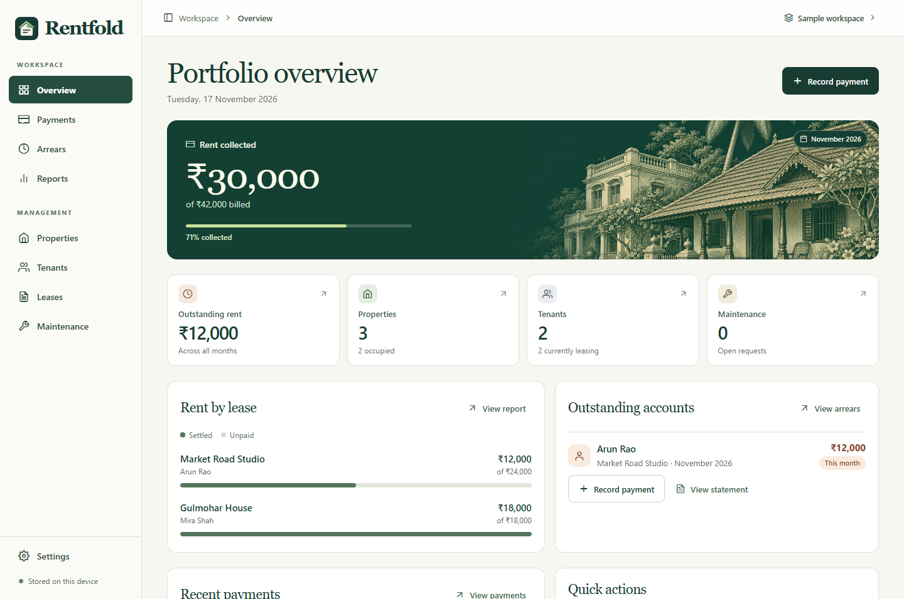

# Rentfold

A local-first rental ledger for landlords managing houses and shops. See who has paid this month, how much rent is outstanding, and how much advance each tenant has available. Records stay on your device and the app works offline after installation.

[Run locally](#run-locally) · [Try the sample portfolio](#try-the-sample-portfolio) · [Backups](#backups)



## Run locally

With Git and Node.js 24.15 installed, open a terminal and run these commands. Other supported Node versions are listed in [package.json](package.json).

```sh
git clone https://github.com/haresh1846/rent_manager.git
cd rent_manager
npm ci
npm start
```

The first launch builds the web app. Open [Rentfold on your computer](http://127.0.0.1:8204/) to see your personal workspace. Next time, run `npm start` from the project folder. Existing Rent Manager records open at the same local address.

## Try the sample portfolio

Open **Settings → Explore sample workspace**. The sample starts with three properties, two active leases, and two rent payments for the current month. Open **Reports** to see how the ₹30,000 collected breaks down by lease and which tenant owes the remaining ₹12,000.

Choose **Settings → Open personal workspace** when you’re ready to enter your own records. Each workspace saves its changes separately.

## Manage a rental

| Task | What you can do |
| --- | --- |
| Set up a tenancy | Add a property and tenant, then create a lease with its dates, agreed rent, and opening advance. |
| Collect rent | Record a full or partial payment for a billing month. Apply an advance when you want to use it toward rent. |
| Review a month | In Reports, choose Billing month to see rent settled and outstanding, or Receipt date to see cash received, refunded, and the net amount for the month. |
| Maintain a property | Log a repair request, mark it resolved, or reopen it. |
| Correct a payment | Open Payments, reverse the original entry with a reason, and record a replacement if needed. The original stays in the history. |
| Handle a move-out | Review unpaid rent and funds held. Record a full or partial refund, or an itemized security-deposit deduction. |
| Follow up on arrears | Open Arrears to see prior-month and current-month balances. Collect against the oldest unpaid installment or open the tenant’s full statement. |

Amounts are in Indian rupees. Each calendar month covered by a lease carries one full installment, including the first and last months. Payments count toward the billing month you select.

## Statements and exports

Open **Tenants → View statement** for itemized rent, payments, held funds, and corrections. **Arrears** covers all unpaid installments across the portfolio. Both screens can export a local Excel workbook with numeric amounts, sortable dates, and separate detail sheets. **Export PDF** opens a formatted A4 preview in the browser. Select **Print / Save as PDF** and choose your local PDF destination.

## Backups

The web app stores records in IndexedDB for the browser profile and local address you use. Bookmark the address above. Closing the browser, stopping the server, and rebuilding the app preserve your ledger. Clearing site data or deleting the browser profile removes it.

- **Export** a JSON file from **Settings → Export backup**. It contains the current workspace’s records, including tenant contact details and payment history in plain text. Keep the file in a private local folder.
- **Restore** from **Settings → Restore from file** in the matching personal or sample workspace. Review the date and record counts before choosing **Replace workspace records**. To keep a copy of the current records, export them first.

New backups use version 2. Rentfold also reads valid version 1 backups. It checks the rent paid against each lease and billing month, reconciles advance and deposit transactions, and verifies payment correction links before replacing records.

## Development

Built with TypeScript, Expo, React Native, and Expo Router.

| Command | Purpose |
| --- | --- |
| `npm run dev` | Start the local development server for code changes. |
| `npm run typecheck` | Check TypeScript types. |
| `npm run lint` | Run Expo lint. |
| `npm test` | Run the ledger and backup tests. |
| `npm run build:web` | Generate the production web export in `dist/`. |

## License

[MIT](LICENSE)
